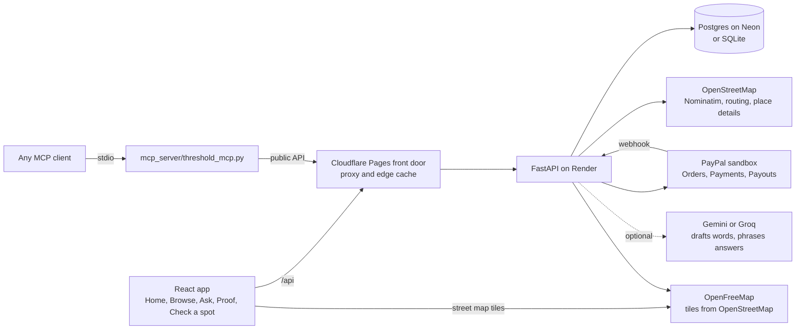

# Threshold

**Neighbors back a new place before it opens. PayPal only holds the money. An assistant works inside limits you set, and every pledge can be checked against PayPal's own record.**

A cafe, a gym or a bakery owner opens a campaign: a pledge amount, a goal of neighbors, a deadline. Neighbors pledge with PayPal, which only *holds* the money. If enough join by the deadline, every hold is collected and the owner is paid. If not, every hold is released and nobody pays.

> **Demo payments only.** Everything runs on PayPal's sandbox: no real money moves. The campaigns on the live demo are fictional.

Live demo: <https://threshold-pledge.pages.dev> · Source: MIT licensed, this repository

## What is new here

**An assistant that cannot spend your money.** On the Ask page you set limits first: the most for one pledge and in all, how many, for how long, which kinds of place, how far. They are a signed token. The assistant finds campaigns and *prepares* a pledge, but the **server** checks every pledge against your limits, and only you can approve it, in PayPal. The model never sees a receipt, an approval link or the numbers in your limits, and has no tool that changes them. Whether a message means "back this one" is decided by fixed rules in code ([`app/intent.py`](app/intent.py)) before any model is asked, and every sentence about a pledge is written by the server, not the model.

**Check, don't trust.** Every pledge is signed (Ed25519) with the exact terms it was made under: the amount, the goal, the deadline and who is paid. PayPal's order carries the terms' fingerprint in its `invoice_id`. A campaign's proof page re-checks each signature, confirms the terms did not change, asks PayPal whether its own record agrees (state, amount, invoice) and says plainly when something differs. It names no one: pledges show a short public reference, never an id that could withdraw them.

**Check a spot.** Enter an address and a kind of business, and see what OpenStreetMap lists within a 10-minute walk on a real street map: the walking area, every place of that kind numbered, and a card for each (its hours, phone and website where volunteers wrote them down, a link to its page on OpenStreetMap and one to its ratings and photos on Google Maps, since OpenStreetMap has none). It shows supply, never demand, and when the map data or the router does not answer it says so instead of guessing. The same map shows where a campaign will be, with its nearest neighbours of the same kind, and Browse puts every open campaign on one.

**Bring your own agent.** [`mcp_server/`](mcp_server) is a stdio MCP server over the same public API, so Claude, Copilot or any MCP client can find campaigns, read one, [check its proof](mcp_server/README.md), and prepare a pledge inside the same limits. It never sees a card or an account.

This borrows the *shape* of agentic payments, a person's signed limits for an agent and a signed record of what was agreed, but it is not an implementation of Google's AP2 or any other protocol.

## How PayPal is used

| PayPal | Where | What for |
|---|---|---|
| Orders v2, intent `AUTHORIZE` | [`app/routes/campaigns.py`](app/routes/campaigns.py) | A pledge is an order that PayPal only authorizes: a hold, not a charge. `custom_id` is our pledge id; `invoice_id` is `{ref}-{terms fingerprint}`. |
| Payments v2: capture, reauthorize, void | [`app/payments/pledges.py`](app/payments/pledges.py), [`app/settlement.py`](app/settlement.py) | At the deadline a funded campaign captures every hold (reauthorizing first when past PayPal's honor period); a missed or cancelled one voids them all. Idempotent and resumable. |
| Payouts | [`app/settlement.py`](app/settlement.py) | The net collected, after PayPal's fees, is paid to the owner's PayPal email, once per campaign. |
| Webhooks | [`app/routes/hooks.py`](app/routes/hooks.py) | Verified with PayPal's verify-webhook-signature API on the raw body; they keep pledges and the payout in step. |
| JavaScript SDK v6 | [`frontend/src/lib/paypalSdk.ts`](frontend/src/lib/paypalSdk.ts) | The PayPal buttons on a campaign's page, in PayPal's own window. |

All of it goes through one small REST client, [`app/payments/paypal.py`](app/payments/paypal.py).

A real end-to-end run against the sandbox ([`scripts/e2e.py`](scripts/e2e.py)): the assistant prepares a pledge, three sandbox buyers approve in PayPal, the proof verifies 3 of 3 against PayPal, the owner closes the campaign, and the Payouts batch matches PayPal's record. A second campaign is cancelled and its hold voided.

## Architecture



| Path | What is there |
|---|---|
| [`app/payments/`](app/payments) | Campaigns, pledges, private receipts, PayPal's REST client, wording rules |
| [`app/trust/`](app/trust) | Signing keys, signed terms, limits, proof |
| [`app/assistant.py`](app/assistant.py), [`app/intent.py`](app/intent.py) | The Ask page's assistant and the rules that decide consent |
| [`app/spot.py`](app/spot.py), [`app/tiles.py`](app/tiles.py), [`app/osmdetails.py`](app/osmdetails.py), [`app/osm.py`](app/osm.py) | Check a spot: the places come from the map's own tiles (Overpass is the backup) |
| [`app/routes/`](app/routes), [`app/db/`](app/db), [`migrations/`](migrations) | HTTP routes, tables, Alembic |
| [`frontend/`](frontend) | React 19, Vite and TypeScript; [`frontend/functions/`](frontend/functions) is the Cloudflare Pages front door |
| [`mcp_server/`](mcp_server) | The MCP server |
| [`docs/`](docs) | [Contract](docs/CONTRACT.md), [testing it step by step](docs/TESTING.md), [agents](docs/AGENTS.md) |

## Try it

Open the live demo and follow [docs/TESTING.md](docs/TESTING.md): browse campaigns, pledge with a PayPal **sandbox** personal account, ask the assistant, open a campaign's proof, check a spot. The sandbox logins for judges are in the Devpost testing instructions.

## Run it locally

Python 3.12 and Node 22.

```bash
python -m venv .venv && source .venv/bin/activate        # Windows: .venv\Scripts\Activate.ps1
pip install -r requirements-dev.txt
cd frontend && npm ci && npm run build && cd ..
cp .env.example .env     # add PAYPAL_CLIENT_ID and PAYPAL_CLIENT_SECRET from developer.paypal.com (sandbox)
AUTH_DEV_LOGIN=true uvicorn app.main:app --port 8000     # sign in with any email; no Google needed
python scripts/seed_demo.py                               # six fictional campaigns (optional)
```

Everything else is optional and documented in [`.env.example`](.env.example): an LLM key (without one the assistant and the drafts use fixed rules), Google sign-in, Postgres, and the key that signs terms (`SIGNING_KEY`; a hosted site prepares no pledges without it, because a restart would make earlier signatures unverifiable).

## Tests

```bash
pytest -q                          # backend: PayPal, the model and the geocoder are fakes; no network
ruff check app tests mcp_server migrations scripts
cd frontend && npm run typecheck && npm test && npm run lint
python scripts/e2e.py              # the whole flow against PayPal's sandbox (see its header for setup)
```

## Honest limits

- **Sandbox only.** The owner is paid straight to a PayPal email. A real marketplace would use PayPal's seller onboarding, platform fees and a refund policy; none of that is faked here.
- **Not an escrow or a guarantee.** A pledge is a PayPal authorization, which lasts 29 days, so campaigns run at most 27. Nothing verifies that the place will open.
- **OpenStreetMap is volunteers' work** and can be incomplete; Check a spot says so with every answer.
- **Free hosting sleeps.** The first request after a quiet spell can take about a minute while the server wakes; the front door says so.
- **The campaigns on the live demo are fictional**, made with [`scripts/seed_demo.py`](scripts/seed_demo.py).

## Starting point

Threshold began from the payments engine and app shell of **Walk-in Founders**, an earlier MIT-licensed project by the same author (the first commit says so): campaigns, pledges as PayPal authorizations, settlement, payouts, webhooks, private receipts and the Cloudflare front door. The signed terms and the proof, the limits and the Ask assistant, Check a spot, the MCP server's `check_proof` and limits, and the pages that carry them were written for Threshold.

## Built with AI

Much of the code was written with GitHub Copilot's agent mode under the author's direction, and tested by the suites above. At run time an optional language model (Gemini through an OpenAI-compatible API, Groq as a fallback) drafts a campaign's words for its owner to edit and phrases the assistant's answers; rules in code check what it writes, and it never sets a number, a link or a payment.

## License

MIT. See [LICENSE](LICENSE). Map data © OpenStreetMap contributors, under the Open Database License; street map tiles by [OpenFreeMap](https://openfreemap.org) (© OpenMapTiles).
