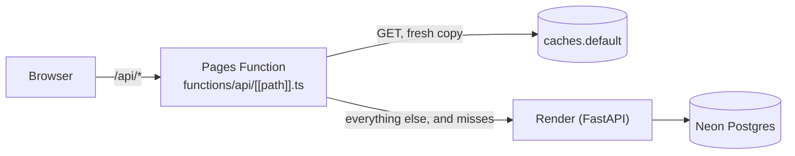

# Threshold: the front end

React 19 and TypeScript, built by Vite 8, served by **Cloudflare Pages**. A Pages Function is the app's **front door** for
`/api`: it hands every API request to the backend on Render and keeps the few shareable answers at the edge. There is no
UI library and no router library: routing is the address itself. Checks: `npm run typecheck` (app, Vite config and the
functions), `npm run lint`, `npm test` (Vitest), `npm run build`.

```
npm ci
npm run dev        # Vite on :5173, /api proxied to the local server on :8770 (THRESHOLD_API to point elsewhere)
npm run build      # typecheck, then dist/ (the backend serves dist/ itself when it is built)
npm run preview    # dist/ on :4173 under the production Content-Security-Policy
```

## Layout

| Where | What |
|---|---|
| `src/main.tsx` | Entry: global styles, starts loading what the opening address needs (`preload.ts`), renders `App` under a crash boundary. |
| `src/App.tsx` | The router: what the address shows and every move between pages (links, Back/Forward). |
| `src/pages/` | One file per page: `HomePage`, `BrowsePage`, `CampaignPage`, `StartCampaignPage`, `MyCampaignsPage`, `AskPage`, `ProofPage`, `SpotPage`, `ReceiptPage`, `PrivacyPage`, `NotFoundPage`; `PageView` picks the page. |
| `src/components/` | Presentational parts: the top bar and its account menu, the page frame and its title block (`Page.tsx`), the sign-in dialog, the confirm dialog, the copy button. |
| `src/components/ask/` | The Ask page: the person's limits (`LimitsPanel`, `AssistantToken`), campaign cards, a prepared pledge. |
| `src/components/founders/` | A campaign's parts: the campaign form, the PayPal buttons (`PayPalPledge`), the private receipt, the poster. |
| `src/components/spot/` | Check a spot's plan of the walk (`SpotPlan`, drawn as SVG). |
| `src/state/` | Small stores read with `useSyncExternalStore`: the person's limits, the campaign being shown, the session, the theme, the route, the waking engine. |
| `src/api/` | The API client (`client.ts`) and the payload types and calls per area: campaigns, trust (limits, proof), the assistant, Check a spot, the account. |
| `src/lib/` | Pure helpers, unit-tested: routes, money and dates, the proof in plain words (`proof.ts`), the assistant's limits lines (`ask.ts`), the plan geometry (`spot.ts`), the poster, the QR code, lazy loading. |
| `src/chunks.ts`, `src/preload.ts` | The parts that load on demand, and what each address needs before it can show. |
| `src/styles/` | Plain CSS with tokens (`tokens.css`); `index.css` is the global sheet, `components.css` the shared parts (buttons, fields, title block), and each page group's styles load with its code. |
| `functions/` | The Cloudflare Pages Function for `/api/*` (`api/[[path]].ts`) and its tested logic (`_lib/proxy.ts`, `_lib/cache.ts`). |
| `public/` | `_headers` (CSP and security headers, immutable caching of `/assets/*`), `theme.js` (sets the theme before first paint), `llms.txt`, the icon. |

## Routes

Routing is the address itself (`lib/routes.ts` parses it; `App.tsx` follows `popstate`); in-app links go through
`components/Link.tsx`, which changes the address in place and fetches what the target needs as it is pointed at.

| Address | Shows |
|---|---|
| `/` | What Threshold is, how a pledge works and the ways in. |
| `/browse` | The open campaigns, newest first or nearest first, and "Start one". |
| `/p/<id>` | A campaign: the supporter's view with PayPal's buttons, or the owner's panel. |
| `/proof/<id>` | A campaign's signed terms and each pledge checked against PayPal. |
| `/ask` | The assistant: the person's limits above, the conversation below. |
| `/spot` | Check a spot. |
| `/start` | Start a campaign (the form, the AI draft, edit, publish). |
| `/me` | The signed-in owner's campaigns. |
| `/r/<token>` | A pledge's private receipt (`noindex`, no referrer, never cached). |
| `/privacy` | The privacy note. Any unknown path shows the not-found page. |

## State and data

- **Limits.** `state/limits.ts` keeps the person's limits token in this browser only (`threshold-limits`), reads what is
  used and left from the server, and drops a token the server says will never work again. The token only ever limits what
  an assistant may prepare; the Ask page offers it to another assistant under **Use these limits with another assistant**.
- **The assistant.** `api/assistant.ts` sends the conversation with the limits in `X-Limits`; `lib/ask.ts` turns limits
  into the lines the page shows. The page renders what the server returns (cards, a prepared pledge with PayPal's own
  link, a refusal in the server's words); it writes none of the sentences about a pledge.
- **Proof.** `lib/proof.ts` is pure: it says what each check found and how the page sums them up. The checks themselves are
  the server's (`app/trust/proof.py`).
- **Engine naps.** Render's free instance sleeps; `fetchAwake` waits through the front door's `503 {"waking": true}`
  (Retry-After, two minutes at most) and `state/engine.ts` shows the waking note. An answer the edge served from its own copy
  (`x-threshold-cache: hit | stale`) says nothing about the engine, so it does not count as the engine answering.
- **PayPal.** `lib/paypalSdk.ts` loads PayPal's JavaScript SDK v6 only on a campaign that takes pledges, and only from
  PayPal's own hosts.

## Loading: code splitting

`chunks.ts` names the parts that load on demand; `lib/lazy.ts` wraps them (`lazyModule`, `lazyComponent`). Each part has a
fallback that holds its place, so nothing moves when it arrives:

| Chunk | Loads | Fallback while it loads |
|---|---|---|
| `homeChunk` | with `/` | the page's empty sheet |
| `campaignsChunk` (browse, a campaign, start, my campaigns, PayPal's buttons, the poster, the campaign styles) | with those pages | the same, "Loading the page…" for screen readers |
| `trustChunk` (Ask, Proof, Check a spot and their styles) | with those pages | the same |
| `privacyChunk` | with `/privacy` | the same |

`main.tsx` starts the opening address's chunk and its answer before the first render. A chunk that fails to load reloads the
page once a minute at most (a newer deploy replaced it); after that the part says it could not load, in its place, and the
rest of the app keeps working.

## The campaign poster

One vector renderer (`components/founders/PosterArt.tsx`) draws the window poster for any campaign from the campaign's own
data: its actual participation perks lead, then its payment terms in plain words and a QR code to the campaign's page.
`lib/posterBrand.ts` chooses a visual direction and palette for the business, `PosterMotif.tsx` draws original
business-related artwork, and text contrast is tested at 4.5:1 or better. The branded QR frame sits outside a five-module
white quiet zone; modules stay sharp black on white, and the QR never points at a private receipt. `lib/posterExport.ts`
embeds the local fonts in SVG and 2400×3392 PNG output without broadening the production CSP, and the same renderer
supplies a one-page A4 or Letter print. If text, terms or perks do not fit, printing and downloading stop with an
explanation instead of dropping words. Campaign posters carry "Demo payments — no real money."

## The front door and its edge cache



`functions/_lib/proxy.ts` (`frontDoor`) adds the proxy headers (`x-client-ip`, `x-proxy-secret`, `x-forwarded-host`; visitors'
own copies are dropped), keeps redirects on the front door's origin, and answers `503 {"waking": true}` while Render shows
its own wake-up page or gateway errors. `functions/_lib/cache.ts` decides what the edge may keep: only a `GET` whose answer
is `200`, `Cache-Control: public` with `s-maxage > 0`, no `Set-Cookie` and no `Vary: *`, keyed by the URL alone. The backend
decides what is shareable (`app/cache_policy.py`): only the public settings, `GET /api/config` and `GET /api/keys`, which
are the same for every visitor and change only with a deploy (an hour at the edge). They also carry `stale-if-error`
(RFC 5861), so a stale copy may answer for up to a week while the backend is waking or down. Everything else is `no-store`:
a campaign's progress, a proof, a receipt, every write and every error. The front door only honors what the backend says.

Every `/api` answer carries `x-threshold-cache`:

| Value | Meaning |
|---|---|
| `hit` | Served from the edge's fresh copy; the backend was not asked. |
| `miss` | The backend answered and the answer is now kept (written after the response, `waitUntil`). |
| `stale` | The backend was waking, down, erroring or slower than 5 s, and a stale copy answered (with `no-store` for the browser). |
| `bypass` | Not kept: other methods, private or uncacheable answers, errors, the waking note. |

Tested with a fake `fetch`, cache and timer: `functions/_lib/cache.test.ts`, `functions/_lib/proxy.test.ts`.

## Security

`public/_headers` (production) and `vite.config.ts` (preview) send the same Content-Security-Policy: scripts and styles from
the app's origin, Google's sign-in and PayPal's checkout hosts only, fonts self-hosted, images over https, no inline script
(the theme is set by `public/theme.js`), `frame-ancestors 'none'`. A change to the PayPal hosts in one of `app/main.py`,
`_headers` and `vite.config.ts` is a change to all three. Receipt pages send no referrer and `noindex, nofollow, noarchive`.

## Performance budget

| Budget | Limit | Now |
|---|---|---|
| Initial JS (the entry and what it modulepreloads), raw | ≤ 400 KB | 247 KB |
| Initial CSS, raw | ≤ 130 KB | 30 KB |
| Layout shift added by lazy loading | none | none (fallbacks hold each part's box) |
| Fonts | self-hosted, `font-display: swap`, not preloaded | as budgeted |
